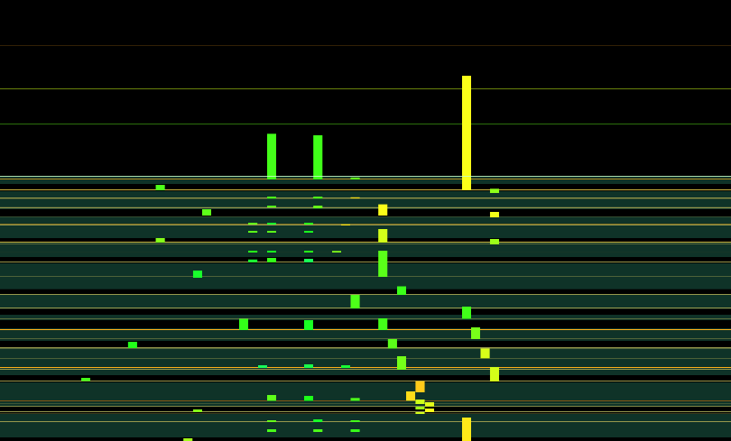

# MVV - MIDI Velocity Visualizer

[](https://opensource.org/licenses/MIT)

[MVV](https://omakoto.github.io/mvv/) is a powerful, web-based MIDI visualizer, recorder, and player designed for piano learners and musicians. It provides real-time feedback on your performance, featuring velocity visualization, pedal tracking, and chord analysis.

<p align="center">
  <a href="https://omakoto.github.io/mvv/">
    
  </a>
</p>

TODO: Screenshot is stale, take a new one

## ✨ Key Features

### 🎹 Real-time Visualization
- **Note Intensity:** Visualizes played notes with color-coded intensity based on MIDI velocity.
- **Chord Analysis:** Real-time chord detection and naming (powered by [Tonal](https://github.com/tonaljs/tonal)).
- **Note Names:** Toggleable note name overlays with support for both sharps (♯) and flats (♭).
- **Pedal Tracking:** Visual feedback for Damper (Sustain) and Sostenuto pedals.
- **Expression Control:** Supports expression MIDI CC (e.g., for digital wind instruments).

### ⏺️ Recording & Playback
- **MIDI Recording:** Record your performance and save it as a standard `*.mid` file.
- **MIDI Playback:** Load and play back existing MIDI files with adjustable speed (0.125x to 16x).
- **"Always Recording":** Automatically records all MIDI input for up to 20 minutes. Hit 'B' to move the recent buffer into the recording for playback or saving.
- **Trim & Sections:** Trim recordings and navigate between section markers.

### ⏱️ Advanced Metronome
- **Polyrhythm Support:** Flexible beat and sub-beat configuration.
- **Auto-Tempo:** Gradually increase or decrease tempo after a specific number of bars or seconds—perfect for practice.

### 🛠️ Customization
- **Display Toggles:** Toggle octave lines, note-off lines, and scroll speed.
- **MIDI Output:** Route MIDI playback to external hardware or software synthesizers.
- **Freeze Mode:** Pause the scroll while continuing to play for detailed analysis.

---

## 🚀 Getting Started

1.  **Open MVV:** Visit [omakoto.github.io/mvv/](https://omakoto.github.io/mvv/).
2.  **Connect MIDI:** Plug in your MIDI controller. MVV will automatically detect it.
3.  **Play:** Start playing! Your notes will appear on the roll.
4.  **Help:** Press `?` at any time to view keyboard shortcuts.

---

## ⌨️ Keyboard Shortcuts

| Key | Action |
| :--- | :--- |
| **`?`** | Show help screen |
| **`1`** | Toggle note names |
| **`2`** | Toggle ♯ / ♭ for key and chord names |
| **`3`** | Toggle octave lines |
| **`4`** | Toggle scroll speed |
| **`5`** | Toggle note-off lines |
| **`6`** | Hide screen (Video Mute) |
| **`7`** / **`Enter`** | Freeze roll pane |
| **`Space`** | Playback start / pause |
| **`R`** | Start / stop recording |
| **`B`** | Replay recent events (from "always recording" buffer) |
| **`S`** | Save current recording as `*.mid` |
| **`L`** | Load a `*.mid` file |
| **`M`** | Start / stop metronome |
| **`F`** | Toggle Fullscreen |
| **`A`** / **`Home`** | Jump to beginning |
| **`Z`** | Stop playback |
| **`←`** / **`→`** | Rewind / Fast-forward |
| **`↑`** / **`↓`** | Adjust playback speed |
| **`0`** | Reset playback speed to 1x |

*For the full list of shortcuts, press `?` in the app.*

---

## 🛠️ Development

MVV is written in TypeScript and uses `npm` for its build process.

### Prerequisites
- [Node.js](https://nodejs.org/) (latest LTS recommended)

### Setup & Build
1. Install dependencies:
   ```bash
   npm install
   ```
   *Note: `@types/webmidi` is pinned to `^2.1.0` to maintain compatibility with the native Web MIDI API. Do not upgrade to v3.*

2. Build the project:
   ```bash
   npm run build
   ```
   The compiled files will be located in the `docs/` directory, which serves as the distribution folder.

### Local Development
To start a local development server with live-reloading:
```bash
npm start
```

---

## 📄 License

This project is licensed under the MIT License - see the [LICENSE](LICENSE) file for details.
